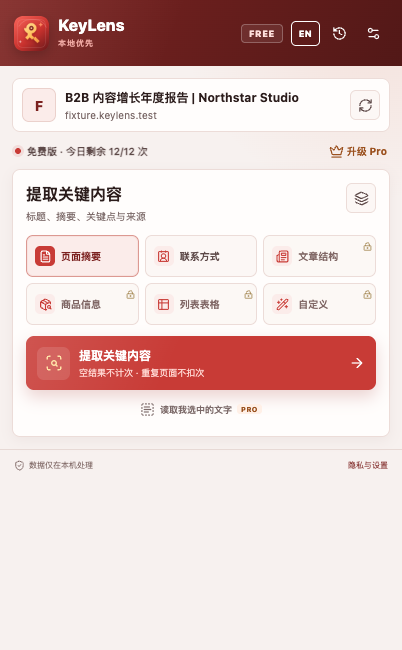
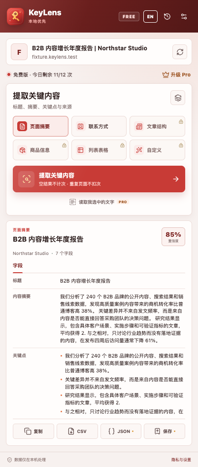
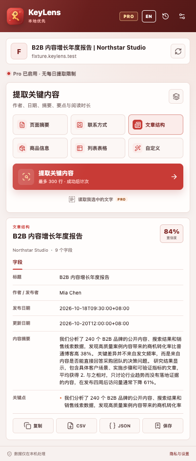
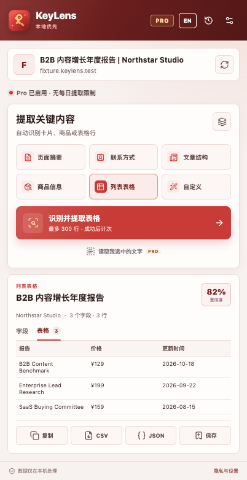
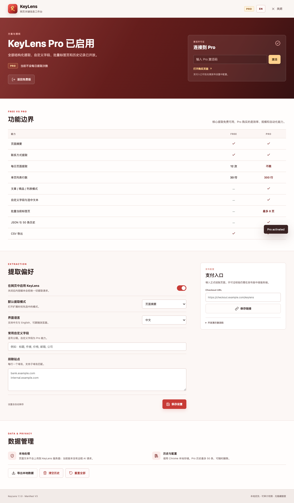
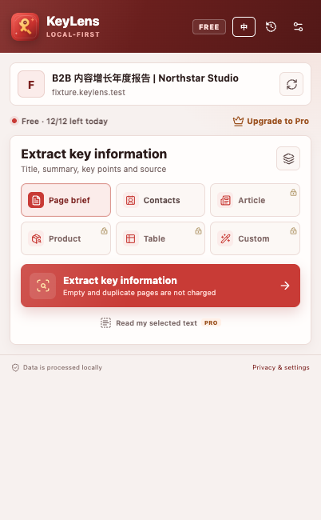
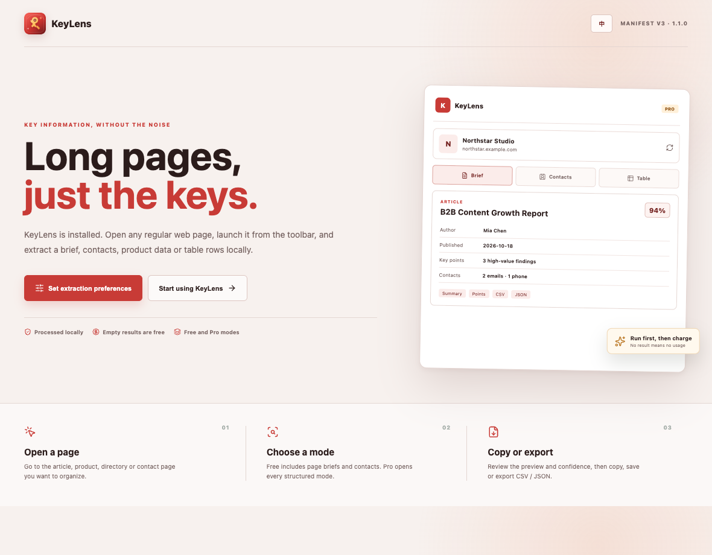

# KeyLens

KeyLens 是一个 Manifest V3 网页关键信息提取扩展。它从 Thunderbit 的能力和近期用户反馈出发，保留“打开页面就能出结构化结果”的效率，同时针对配额不透明、空结果计费、重复行、多页流程难理解等问题重新设计。1.1 版采用深酒红、绯红与金色品牌体系，并完整支持中文和英文界面。

## 产品定位

KeyLens 不试图复制完整的 AI 爬虫平台，而是把高频工作压缩成一条可检查的流程：

1. 识别当前页面是文章、商品、联系人还是列表。
2. 在本机提取字段、表格和来源。
3. 展示字段、行数和置信度。
4. 复制、保存或导出。

免费版可完成真实任务，Pro 购买的是结构化范围、吞吐量和批量效率。



扩展跟随浏览器语言启动，也可以在任意界面点击 `EN / 中` 即时切换。语言会保存到本地设置，并同步影响提取字段名称、设置页和安装引导。

## 免费版

- 页面摘要：标题、摘要、关键点、作者、日期和来源。
- 联系方式：邮箱、电话、公司、地址和社交主页。
- 每天 12 次成功提取。
- 单页最多 30 行列表结果。
- CSV 导出与复制。
- 空结果不计次，同一页面 15 分钟内重复提取不重复计次。
- 所有文本在浏览器本地处理。

## Pro

- 文章结构、商品信息、列表表格与自定义字段。
- 单页最多 300 行。
- 不设每日提取次数限制。
- 选中文本摘要。
- 当前窗口最多 8 个标签页批量提取。
- JSON 导出。
- 最多 50 条本地历史记录。
- 7 天一次性试用。

本仓库提供本地开发激活码 `KEYLENS-PRO-DEMO` 用于验收免费/付费差异。它是不安全的本地演示实现；正式上架前必须替换为服务端许可证校验。

| Free 页面摘要 | Pro 文章结构 |
| --- | --- |
|  |  |

| Pro 列表表格 | 设置与方案 |
| --- | --- |
|  |  |

## 安装

1. 打开 Chrome 的 `chrome://extensions`。
2. 开启右上角“开发者模式”。
3. 点击“加载已解压的扩展程序”。
4. 选择本项目根目录。
5. 打开任意普通 HTTP/HTTPS 页面，点击工具栏中的 KeyLens。

| 英文界面 | 安装引导 |
| --- | --- |
|  |  |

无需构建即可运行。`node_modules/` 只用于本地自动化测试。

## 验证

```bash
npm install
npm test
npm run validate
npm run ui
npm run package
```

- `npm test`：核心文本解析、价格、联系方式和 DOM 提取夹具。
- `npm run validate`：Manifest、图标、脚本、隐私与商店文档完整性。
- `npm run ui`：Chrome for Testing 加载扩展，截图 popup、设置页、引导页和提取结果。
- `npm run package`：生成可上传商店的 `dist/keylens-1.1.0.zip`。

## 项目结构

```text
manifest.json
assets/                 品牌 SVG 与 16/32/48/128 PNG
_locales/               Manifest 中英文名称与描述
src/
  i18n.js               中文 / English 文案与即时切换
  core.js               本地解析与结构化提取
  content.js            当前页面消息、选中文本与权限检查
  background.js         额度、试用、Pro、历史与设置
  popup.*               提取工作台
  options.*             方案、偏好、支付链接和数据管理
  welcome.*             安装引导
vendor/lucide.min.js    Lucide 图标
tests/                  单元测试、页面夹具与 Chrome UI 测试
docs/                   研究和商店文案
```

## 已知边界

- 只支持普通 HTTP/HTTPS 页面；`chrome://`、扩展商店和浏览器内部页面不可注入。
- 当前没有远程 AI、自动翻页、子页面爬取、定时任务或 OCR。
- 结构化识别依赖通用语义选择器、JSON-LD 与启发式规则，复杂动态站点可能只返回部分字段。
- 支付入口可配置，但没有内置支付或服务端许可证校验。
- 批量功能只处理用户当前已打开的标签页，不主动打开新页面。
- 本地规则不等于 AI 语义理解；低置信度结果应在导出前人工检查。
- 界面语言只影响扩展 UI 和字段标签，不翻译网页原文。

## 文档

- [Thunderbit 研究](docs/RESEARCH.md)
- [商店上架文案](docs/STORE-LISTING.md)
- [隐私说明](PRIVACY.md)
